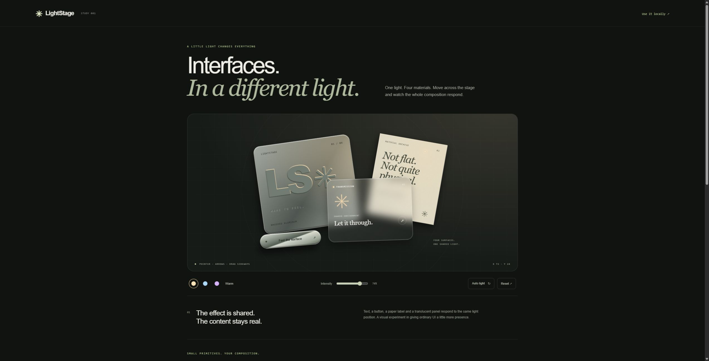

# LightStage

One shared stylized light across metal, glass and paper. Real React content, ordinary CSS, a small API.

MIT licensed. The package is not published to npm; install the GitHub source archive below. `private: true` guards against accidental npm publication and does not restrict the MIT license.



## Run the showcase

Use Node 20.19+ and npm. From this folder:

```sh
git clone https://github.com/thakoreh/lightstage.git
cd lightstage
npm ci
npm run dev
```

Open the printed loopback URL. The first composition preserves the approved LightStage study; the second example demonstrates independent state and editable content. Use pointer movement, sideways touch movement, or focus the stage and press arrow keys. Home restores that scene's initial settings. Vertical touch scrolling and pinch zoom remain native. Auto light starts only when requested and yields to manual stage input.

## Install in a React 19 app

```sh
npm install https://github.com/thakoreh/lightstage/archive/refs/tags/v0.1.1.tar.gz
```

This installs the committed ESM, TypeScript declarations and CSS as `@lightstage/react`. No consumer build toolchain is needed to generate the library output. This version tag is stable; use a commit archive URL when you need an exact source revision. There is no published npm package or hosted shadcn registry. The archive handles package installation and the three canonical source files handle editable copies, so this small release does not need a separate registry service.

For an editable source copy, copy `src/index.tsx`, `src/state.ts` and `src/style.css` together, retain their relative imports, and import from your local module. LightStage's MIT license and existing dependency notices travel with redistributed code.

```tsx
'use client'; // Needed in an app-router client entry, not in a Vite app.
import { LightStage, Material, MetalButton } from '@lightstage/react';
import '@lightstage/react/style.css';

export function Card() {
  return (
    <LightStage style={{ padding: 32, background: '#202820' }}>
      <Material kind="paper" style={{ maxWidth: 320, marginBottom: 24 }}>
        <h2>Your real content.</h2>
        <p>Keep headings, links and form controls in the DOM.</p>
      </Material>
      <MetalButton onClick={() => console.log('Saved')}>Save</MetalButton>
    </LightStage>
  );
}
```

Import the CSS once. The library supplies surface treatments; you supply layout, dimensions and content. It does not ship the showcase's global resets, absolute positioning, decorative grid, orbit lines, headline or specimen copy.

## API

| Export | Contract |
| --- | --- |
| `LightStage` | A forwarded-ref `div`, context provider and event boundary. Accepts normal div props. `defaults?: {x, y, intensity, palette}` is read once per mount. `interactive?: boolean` defaults to true. `controls?: ReactNode` renders after the scene's DOM root while retaining its context, so controls do not alter its light geometry. |
| `Material` | A forwarded-ref div with `kind: 'metal' \| 'glass' \| 'paper'`. Accepts normal div props and children. |
| `MetalButton` | A forwarded-ref native button with the chrome treatment; defaults to `type="button"`. Pass normal button props including `disabled`, `onClick` and form attributes. |
| `useLightStage()` | Reads the nearest scene and returns `x`, `y`, `intensity`, `palette`, `auto`, `reducedMotion`, `setPosition(x,y)`, `setIntensity(n)`, `setPalette(name)`, `setAuto(boolean)` and `reset()`. Requires a scene ancestor or the controls slot. |
| `palettes` | Readonly warm, cool and violet RGB values. Types `Palette`, `LightPosition`, `LightState`, `LightDefaults`, `LightStageProps`, `MaterialProps`, `MaterialKind`, `MetalButtonProps` are exported. |

Positions are normalized to the scene rectangle and clamp to 0.03–0.97. Intensity clamps to 0–1. Nonfinite numeric updates preserve the prior value; invalid initial numbers use defaults. Default position is `(0.72, 0.24)`, intensity `0.78`, palette `warm`. Reset restores **that scene's initial defaults**, with auto off. Change the component's `key` to initialize a different scene; defaults are not controlled props.

```tsx
import { LightStage, useLightStage } from '@lightstage/react';

function Controls() {
  const light = useLightStage();
  return <button aria-pressed={light.auto}
    disabled={light.reducedMotion}
    onClick={() => light.setAuto(!light.auto)}>Auto light</button>;
}

export function Scene() {
  return <LightStage controls={<Controls />} defaults={{ palette: 'cool' }}>
    {/* Your materials */}
  </LightStage>;
}
```

State is internal to each scene. The hook controls it imperatively; fully controlled `value/onChange` props are not part of this version. Hook consumers update at most once per animation frame during pointer movement. Put the hook in small readouts or controls rather than in the entire material tree.

## Styling tokens

All effect variables are scoped under `.ls-stage`. Override styling through className, style or these tokens:

| Token | Purpose |
| --- | --- |
| `--ls-focus` | Focus ring color, default `#c6d5a6`. |
| `--ls-radius` | Metal/glass corner radius, otherwise 24px/22px. |
| `--ls-glass-ink` | Glass text color, default `#efeee7`. |
| `--ls-glass-fallback` | Glass background without backdrop-filter, default `#303a32`. |
| `--ls-x`, `--ls-y`, `--ls-power`, `--ls-light` | Scene output, managed by the engine. Use the hook to change it. |
| `--ls-mx`, `--ls-my`, `--ls-sx`, `--ls-sy` | Material-local highlight/shadow output. Available for decorative treatments such as embossed text. |

Emboss text in consumer CSS with `text-shadow` based on the local shadow tokens; see `.emboss` in `example/style.css`. Surface wrappers themselves contain no brand text or logo.

## Interaction, motion and rendering

- Input is scoped to the closest scene. Nested scenes and independent siblings keep their own state. Root keyboard handling ignores keys from descendants, including inputs and buttons. Pointer input ignores interactive descendants.
- Touch uses `touch-action: pan-y pinch-zoom`, no global touch listeners or pointer capture. The browser may cancel a gesture to scroll; cancellation discards queued light movement. A tap on blank scene space may reposition the light.
- Automatic motion is opt-in, stops on reduced-motion preference and pauses while the document is hidden or the scene is offscreen. Pause time is excluded from motion progression. Manual pointer/keyboard positioning turns auto off. Unsupported observers degrade to visibility-aware animation and window resize handling.
- Pointer updates use one queued frame per scene. Geometry is read in a batch before per-material writes. ResizeObserver tracks roots and materials; window resize/scroll recalculates highlights. Large trees, moving transforms and expensive backdrop blur still have a cost; no universal frame-rate claim is made.
- Dynamic DOM size changes are observed. If application CSS animates only a material's transform while the light is stationary, automatic tracking of every transform frame is outside this version; a light update or resize/scroll recalculates it.
- The module touches browser APIs only in effects or event handlers and renders useful deterministic HTML with React SSR. It ships a preserved `'use client'` boundary for React frameworks. Effects attach after hydration. Provide a client entry for event handlers in frameworks that require one.
- CSS contains no global resets. JavaScript-disabled SSR content stays readable with static gradients; CSS-unavailable content remains semantic DOM. Glass has an opaque fallback and forced colors use system colors. Consumer text contrast remains the consumer's responsibility.

This is a stylized CSS illusion. It does not simulate physical light transport, reflections, refraction or ray tracing. Rectangle-based highlights approximate transformed surfaces; they are not a 3D lighting model.

## Coding-agent skill

After installing the package, run this from the consumer project to install the included LightStage skill for Codex and other agents that discover `.agents/skills`:

```sh
node node_modules/@lightstage/react/scripts/install-agent-skill.mjs .
```

The installer writes only `.agents/skills/lightstage/SKILL.md` inside the selected project. It preserves identical existing content and refuses to overwrite a different skill. The skill teaches the actual API, CSS import, defaults, scene isolation and accessibility checks.

## Verification and maintenance

```sh
npm run typecheck
npm test
npm run build
npm run pack:check
```

`pack:check` packs the actual artifact, installs it into an isolated ignored consumer using the npm cache when available, verifies ESM import and server rendering, typechecks that consumer and produces a Vite bundle including the exported CSS. Consumer verification may fetch registry metadata; it never publishes a package. The resulting fixture remains in `.consumer-check/` for inspection.

See [verification evidence](docs/VERIFICATION.md), [integration instructions for coding agents](docs/FOR-AGENTS.md), and the [release checklist](docs/RELEASE.md). The checked-in `reference/` is the original approved source, retained for comparison. Its 21 mock-DOM assertions are historical baseline coverage, not visual or accessibility certification.

## Provenance and license

The original owned LightStage study is the visual and code source. The approved source is retained in `reference/` for comparison.

LightStage is [MIT licensed](LICENSE), copyright 2026 Hiren Thakore. React and development-tool licenses remain their respective authors' licenses; see [NOTICE.md](NOTICE.md).
